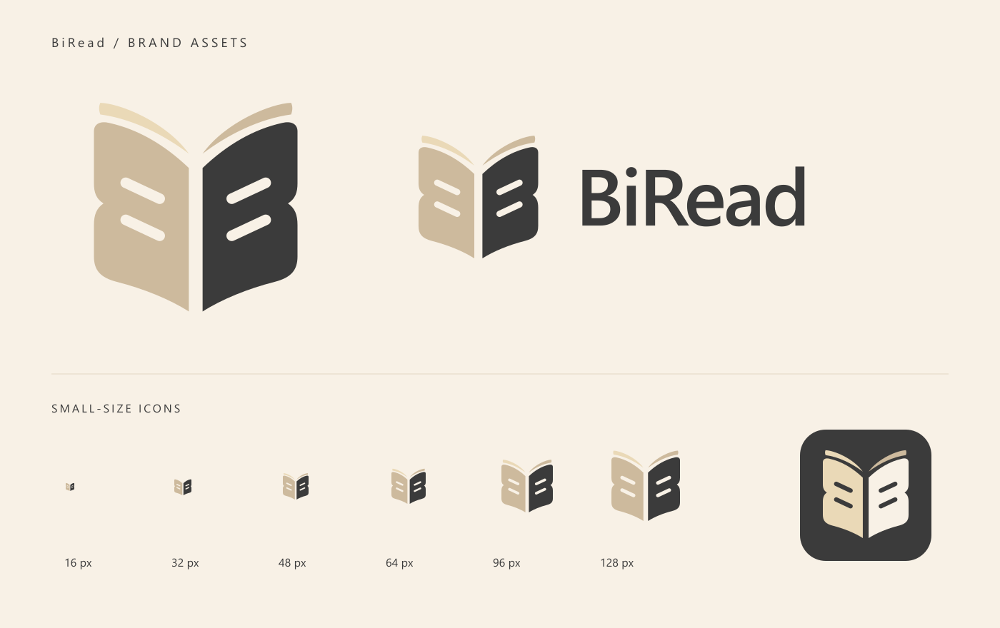

# BiRead 标识文件

根据提供的参考图重新绘制，采用镜像 B 与翻开的书的造型。

- biread-icon.svg / .png：标准独立图标，PNG 为 512 × 512 透明底。
- biread-icon-small.svg：小尺寸简化版。
- biread-icon-16.png 至 biread-icon-256.png：常用尺寸图标。
- biread-icon-dark.svg / .png：适合深色背景的浅色版本。
- biread-wordmark.svg / .png：图标 + BiRead 横版标识，1200 × 360 透明底。
- preview.png：效果预览，不用作插件图标。

SVG 可无损缩放。横版 SVG 的文字可编辑，使用 Segoe UI，缺少该字体时会回退到 Arial；如需固定显示效果，请使用 PNG。

插件使用 48 px 和 96 px 图标，应用于插件管理列表、设置入口及共用该图标的菜单。

开发者重新生成：安装 Node.js 和 sharp 后运行 node generate.cjs；也可通过 SHARP_MODULE 指定已有 sharp 模块的位置。

